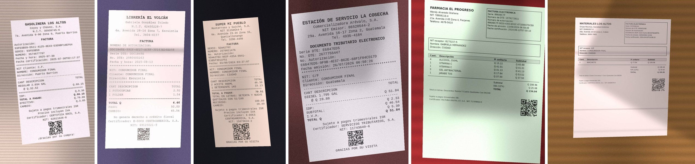
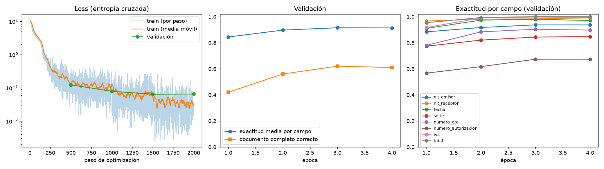
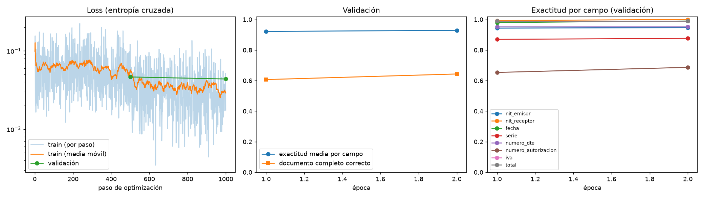
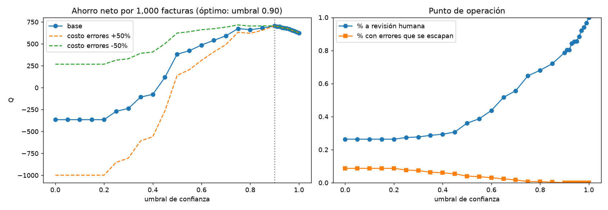

# Resultados del modelo propio (Donut)

Resumen de las iteraciones de entrenamiento del 2 de noviembre de 2026. Todas las figuras y tablas están en [`docs/donut/`](docs/donut/). Para reproducirlas, ver la sección "Modelo propio: Donut" del README.

> **Importante:** todas las métricas de este documento son sobre **facturas sintéticas** de validación. Todavía no hay fotos reales anotadas. El desempeño con fotos reales hay que medirlo con `eval/run_eval.py --methods donut` y `eval/threshold_curve.py --gt eval/ground_truth.csv` en cuanto exista `eval/ground_truth.csv`, y es de esperar que sea menor.

## Datos

- **Entrenamiento:** facturas FEL sintéticas generadas con `train/synth_fel.py`: tickets térmicos (80 %) y hojas carta (20 %) de seis tipos de comercio, "fotografiadas" con perspectiva, sombras, desteñido, arrugas, desenfoque, ruido y JPEG. Los datos son ficticios pero cumplen las reglas FEL: NIT módulo 11, serie y número derivados del número de autorización, IVA 12/112 o IDP.
- **Lote 1** (`data/synth`): 4,000 de entrenamiento + 300 de validación.
- **Lote 2** (`data/synth2`): 4,000 + 300, con otra semilla y el formato carta corregido (ver análisis de errores).

## Iteraciones

| Iteración | Cambios | Exactitud por campo | Documento 100 % correcto | Nº autorización | Ahorro neto (Q/1,000 facturas)* | Costo de entrenamiento |
|---|---|---|---|---|---|---|
| it1 | Fine-tuning de `donut-base-finetuned-cord-v2` con el lote 1, 4 épocas, lr 4e-5 | 0.923 | 0.603 | 0.680 | 702 (umbral 0.90) | 3.4 h en RTX 3070 Laptop (8 GB) |
| **it2 (final)** | Parte de it1 + lote 2 (carta corregido), 2 épocas, lr 2e-5 | **0.930** | **0.650** | **0.693** | **705** (umbral 0.90) | +1.7 h |
| it2 + decodificación restringida | Mismo modelo; en inferencia solo se permiten tokens con formato válido | 0.925 | 0.620 | 0.667 | 679 (umbral 0.95) | 0 (solo inferencia) |

\* Sobre la validación del lote 2 (300 facturas). Digitar todo a mano cuesta Q1,000 por cada 1,000 facturas con los supuestos de `.env.example`: 2 min por factura, Q30/hora. Sobre la validación del lote 1 los resultados son casi iguales (it1 0.916 / it2 0.916 por campo). La tabla completa está en `docs/donut/comparacion_iteraciones.csv`.

- **Latencia:** 0.22 s por factura en GPU (RTX 3070, bf16, lotes de 8) y unos 5 a 10 s en CPU.
- **Costo por factura:** ≈ Q0, porque corre local y no paga API.
- **Tamaño del modelo:** 201 M de parámetros, 400 MB en bf16.

### Curvas de entrenamiento

- La loss de entrenamiento baja de ~11 a ~0.03. La de validación se aplana desde la época 3 (0.064 → 0.065), mientras la de entrenamiento sigue bajando: es el **inicio de sobreajuste**. Por eso se guarda el mejor modelo según la validación (época 3) y no el último.
- La época 4 no mejoró nada (0.9146 → 0.9133 de exactitud por campo): **rendimientos decrecientes** con estos datos.
- Lo que más cuesta es el número de autorización (36 caracteres hexadecimales sin contexto lingüístico). El total y el IVA llegan a 99–100 %.

## Análisis de errores

1. **Iteración 1:** en una muestra de la validación, *todos* los errores del número de autorización estaban en el formato carta. La causa: el generador recortaba la hoja al contenido (quedaba casi cuadrada) y achicaba la letra del UUID para que cupiera en el recuadro, así que al reducir la foto a 960 px de ancho el texto quedaba ilegible. Se corrigió en el lote 2 (hoja carta vertical completa, letra más grande).
2. **Iteración 2:** el formato carta sigue siendo el punto débil: solo 28 % de documentos carta salen perfectos, contra 74 % de los tickets. Una hoja carta completa a 1280×960 deja el UUID en ~10–14 px de alto. Arreglarlo de verdad requiere **más resolución de entrada** (más memoria y tiempo), o un recorte previo de la zona del encabezado.
3. En los tickets, los errores restantes del UUID son de **1 o 2 caracteres**: confundir 1/I, C/6 o 0/8, un guion de más o un carácter extra. Muchos producen un UUID con formato inválido, que las validaciones FEL atrapan y mandan a revisión.

## Modelo de valor: umbral de operación

Una factura va a revisión humana si falla alguna validación FEL o si algún campo tiene confianza menor al umbral. Con el modelo final (it2), sobre la validación del lote 2:

| Política | % a revisión | % con errores que se escapan | Ahorro neto (Q/1,000) |
|---|---|---|---|
| Confiar en el modelo (solo validaciones FEL) | 26 % | 8.7 % | **−365** (peor que digitar a mano) |
| Umbral 0.5 | 36 % | 4.0 % | 382 |
| **Umbral 0.90 (óptimo)** | **79 %** | **0 %** | **705** |
| Revisar todo (el modelo solo prellena) | 100 % | 0 % | 625 |

Conclusiones para el informe:

- **El punto de operación importa más que la métrica técnica.** Pasar de it1 a it2 subió la exactitud por documento de 0.603 a 0.650, pero el ahorro en el umbral óptimo apenas cambió (Q702 → Q705). En cambio, elegir mal el umbral convierte un ahorro de Q705 en una pérdida de Q365, porque un error que se escapa (Q5–Q50 según el campo) cuesta mucho más que revisar (0.75 min ≈ Q0.38).
- **Incluso revisando todo, el modelo ahorra 62.5 %**, porque revisar campos prellenados es más rápido que digitarlos. El umbral óptimo agrega Q80 por cada 1,000 facturas, al aceptar sin revisión el 21 % de facturas en las que el modelo está seguro.
- **Sensibilidad** (`docs/donut/sensibilidad_it2.csv`): con el costo de los errores ±20 % o +50 %, el umbral óptimo sigue en 0.90; con −50 % baja a 0.75 y el ahorro casi no cambia (Q716). El resultado es muy sensible a los **minutos de digitación manual**: con −50 %, el ahorro cae a Q205 por cada 1,000 facturas, con +50 % sube a Q1,205. Ese supuesto es el que más vale validar con un contador real.
- El umbral por defecto de la app (`DONUT_MIN_CONF`) quedó en **0.90** por este análisis.

## Decodificación restringida: mejor formato no es más valor

Se implementó una restricción en inferencia (`DONUT_CONSTRAINED=1`, en `src/donut.py`): mientras el modelo escribe un campo, solo se permiten tokens que mantienen su formato (UUID hexadecimal 8-4-4-4-12, NIT con dígito o K, fecha AAAA-MM-DD, montos con dos decimales). Garantiza que la salida siempre tenga formato válido, pero:

- **No mejora la exactitud** (0.925 contra 0.930 por campo): cuando el modelo "lee" una I en vez de un 1, la alternativa válida más probable suele ser otra equivocada.
- **Empeora el valor:** sin umbral, los errores que se escapan suben de 8.7 % a 16.3 %. Un UUID con formato inválido lo detectan las validaciones FEL; con la restricción, el mismo error sale con formato válido y pasa sin revisión. También baja la utilidad de la confianza: el umbral óptimo sube a 0.95 y el ahorro baja a Q679.
- **Decisión:** queda **apagada** por defecto. Es un buen ejemplo de una mejora técnicamente atractiva que reduce el valor de negocio.

## Limitaciones y siguientes pasos

1. **Fotos reales.** Juntar y anotar 40–60 facturas reales (ver `eval/README.md`) y medir la caída frente a la validación sintética. Usar una parte para ajustar el modelo (`train/train_donut.py --extra eval/ground_truth.csv`, solo con filas `split=train`).
2. **Facturas carta.** Probar más resolución de entrada (p. ej. 1536×1152, que en 8 GB requiere batch 1 y probablemente congelar parte del encoder), o recortar automáticamente el recuadro del encabezado antes del modelo.
3. **Revisión por campo.** Hoy una factura dudosa se revisa completa. Revisar solo los campos marcados reduciría el tiempo de revisión y movería el óptimo.
4. **Comparar contra los otros extractores** (baseline, OCR+LLM, Gemini) con las mismas fotos reales en `eval/run_eval.py`. El argumento de Donut es costo ≈ 0, funcionar sin internet y no enviar datos a terceros. Falta medir cuánta exactitud se sacrifica a cambio.
